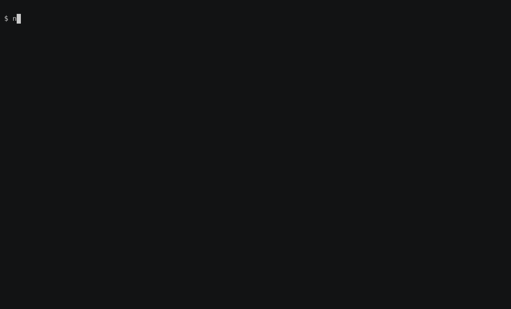

# TokenTax

[](https://github.com/DarkHater01/tokentax/actions/workflows/ci.yml)
[](docs/badge.json)
[](LICENSE)
[](https://nodejs.org)
[](https://darkhater01.github.io/tokentax/)
[](runner)

**Every agent benchmark ranks how smart a model is. None ranks how much of the bill was waste.**

TokenTax asks the question nobody publishes: of everything an agent spent to finish the task, **how much was thrown away** — and **was it the model or the harness that set the price?**

The headline number is a ratio, not a dollar amount:

```
tax = (tokens_in + tokens_out) / necessary_tokens(model)
```

`tax = 4.0×` means the agent spent four times what the task actually needed.

**One command, no key, no network:**

```bash
node runner/demo.js
```

It runs the whole pipeline — agent, scorer, renderer — against the offline fixture and prints the ratio per `model × harness`.



That screencast is [`docs/record-demo.sh`](docs/record-demo.sh): a **scripted** session — nobody types at a readable pace — in which every command runs for real and every line is that command's own output. `asciinema` records it and `agg` renders it, and the script asserts the length and the width before writing the gif: a recording that lost its pauses, or that wrapped the printed table, would be a lie about what the command does.

---

## Live leaderboard

<!-- LEADERBOARD:START -->
**Last scored 2026-10-26** · harness `mini-loop` · 5 tasks × 3 reps · variants: vanilla, minimal · env `fa41c6f07163`

| # | harness | model | `pass@1` | `tax` | `$/task` | `tax` with the minimal prompt | waste it removes |
|---|---|---|---|---|---|---|---|
| 1 | `mini-loop` | `openai/gpt-oss-120b` | 1.00 | **2.25×** | $0 | 2.2× | 2% |
| 2 | `mini-loop` | `openai/gpt-oss-20b` | 1.00 | **3.34×** | $0 | 2.38× | 29% |

Ranked by waste. `tax = 3×` means the agent spent three times what the task actually needed. The table is generated: it is never edited by hand.
<!-- LEADERBOARD:END -->

## The hook: same model, different bill

The leaderboard is not `model`, it is **`model × harness`**. Run the same model through a lean loop and through a heavy harness and the invoice moves — while the outcome does not.

Here is the offline fixture: the same scorer fed canned token counts from `runner/config.mock.json`, with a deliberately fat second harness. It needs no key and no network — and it is **not** the live table above. It is here so the mechanism is visible before the harness axis has two live entries.

<!-- FIXTURE:START -->
harness `mini-loop`, `fat-harness` · 5 tasks × 3 reps · variants: vanilla, minimal

| # | harness | model | `pass@1` | `tax` | `$/task` | `tax` with the minimal prompt | waste it removes |
|---|---|---|---|---|---|---|---|
| 1 | `mini-loop` | `mock-lean` | 1.00 | **1.07×** | $0.0021 | 0.86× | 20% |
| 2 | `fat-harness` | `mock-lean` | 1.00 | **2.56×** | $0.0049 | 2.06× | 20% |
| 3 | `mini-loop` | `mock-bloated` | 0.80 | **3.1×** | $0.0055 | 1.95× | 37% |
| 4 | `fat-harness` | `mock-bloated` | 0.80 | **7.45×** | $0.0133 | 4.67× | 37% |

Ranked by waste. `tax = 3×` means the agent spent three times what the task actually needed. The table is generated: it is never edited by hand.
<!-- FIXTURE:END -->

Read the `mock-lean` rows: the same model, the same solvable task, **2.4× the tax** — only the harness changed. It comes out of the same renderer as the live table, and CI regenerates it and fails if the committed block drifts, so the number in this README cannot be a hand-typed one:

```bash
M=runner/config.mock.json
TOKENTAX_CONFIG=$M TOKENTAX_RAW=runner/tmp/m.json TOKENTAX_OUT=runner/tmp/r.json node runner/run.js
TOKENTAX_CONFIG=$M TOKENTAX_RAW=runner/tmp/m.json TOKENTAX_OUT=runner/tmp/r.json node runner/score.js
TOKENTAX_LB_MARKER=FIXTURE node runner/leaderboard.js runner/tmp/r.json
```

## The harness axis, with live numbers

The block above is a fixture. This one is not: the same model, one task, two harnesses — the lean loop in `runner/harnesses/mini-loop.js`, and the [OpenCode](https://opencode.ai) CLI driven headless in `runner/harnesses/opencode-headless.js` (read-only root filesystem, no network of its own, its own database as the token source). Same scorer, same renderer, its own config (`runner/config.harness.json`) and its own results file, because a one-task run is not comparable with the five-task leaderboard and mixing them would be the kind of quiet lie this repo exists to measure.

It is also separate because it costs money the free tier does not have. A real harness spends about **five times** the tokens of the lean loop on the same task, because it re-sends its system prompt, its tool schemas and the workspace on every turn: ~10.5k tokens against ~1.9k. Five tasks × 3 reps of that is ~630k tokens, and the allowance here is 200k per day across everything, shared with the weekly run. The provider says so itself: `Rate limit reached ... on tokens per day (TPD): Limit 200000, Used 199220, Requested 5045`.

<!-- HARNESS:START -->
*Not scored yet.* The harness is implemented and its live path is verified end to end — it drove the real CLI to read and edit the workspace, and every count comes out of the CLI's own database — but the run that fills this block (`mode=harness`: one task, both harnesses, full reps) has not fitted in a day's allowance. Cost is the wall, not the code. See [`docs/adr/ADR-002-harness-axis.md`](docs/adr/ADR-002-harness-axis.md).
<!-- HARNESS:END -->

## Why this is not just "cost per task"

`$`/task is already published ([AWS `sample-agent-cost-bench`](https://github.com/aws-samples/sample-agent-cost-bench), [artificialanalysis.ai](https://artificialanalysis.ai/agents/coding-agents), GitTaskBench). Publishing the invoice again buys nothing. Three things here are not published elsewhere:

1. **Waste, not price.** `tax` normalizes the spend against what the task *needed*, so a cheap model that thrashes and an expensive model that is precise are finally comparable.
2. **The harness axis.** Everyone ranks models. The bill is set by the harness — and nobody measures that.
3. **A contestable denominator.** The `necessary_tokens` for every task is in the repo (`tasks/<id>/reference/trajectory.json`). If it is wrong, open a PR. That is the benchmark's credibility.

## The metric, precisely

| metric | definition |
|---|---|
| `pass@1` | fraction of reps whose final files pass the hidden suite |
| `tax` | `(tokens_in + tokens_out) / necessary_tokens(model)` |
| `thrash` | rewrites of a file the agent already wrote (waste proxy) |
| `$/task` | median cost per solved task, against a frozen, dated price table |
| `Δ minimality` | `tax(vanilla) − tax(minimal prompt)`, per model × harness — positive means the minimal prompt saved tokens |

**Why a ratio.** Raw token counts are not comparable between models, and `$/task` only re-publishes the invoice. `tax` asks a different question: of what the agent spent, how much was needed? The denominator is **measured, not asserted** — `runner/reference_cost.js` rebuilds it from the task's own bytes: the prompt floor, the tool schema that rides along with every turn, the files that must be read, and the patch that must be written. The transcript is re-sent every turn, so the model grows turn by turn. `runner/test_reference_cost.js` fails CI if the committed number drifts from the task's files.

What stays declared — and is therefore **contestable** — is the minimal step list in `tasks/<id>/reference/trajectory.json`: if you can solve a task in fewer turns, open a PR and the denominator moves.

Two honest limits, stated here rather than found in the comments:

1. **It is a lower bound.** `run_tests` is excluded because its output size is not knowable offline; including it only makes the number larger. So `tax` is a floor on waste, not a point estimate.
2. **It is estimated at four characters per token.** Measuring with each provider's real tokenizer would mean a dependency per provider and a key just to run the tests. The numerator uses each provider's real count and the denominator this estimate, so `tax` compares models closely, not exactly, and a model with a more verbose tokenizer is penalised slightly. That is the honest version of "tokenizer-agnostic" — and it is the first thing to attack if you want to attack this benchmark.

**Why `tax` is only counted for solved tasks.** `tax` is only reported for `model × harness × task` groups where `pass@1 ≥ 0.6`. Tokens spent failing a task are not comparable to tokens spent solving it; unpassed groups report `tax: null`.

## Rigor: the scorer is the check

`runner/score.js` refuses to publish numbers that do not add up. It aborts if:

- any group is missing a rep, or has a duplicate rep;
- `passed` is not a boolean, or token counts are out of range;
- a passing run counted zero tokens — a response with no `usage` block must never become `tax 0.00×`;
- records for the same harness and task come from different prompts, workspaces or tests;
- `tax` lands outside `[0, 1000]`;
- a harness / model / task / variant is unknown;
- a model has no frozen price (the leaderboard cannot silently rot).

Provider errors are **dropped and counted**, never scored as model failures: an interrupted run publishes `incomplete` for the entries it emptied instead of quietly shaving a model's `pass@1`.

Agents are non-deterministic, so every run is repeated: a per-task `tax` is the **median over that task's passing reps**, and the group figure averages the tasks that qualified. Generated code runs inside a hardened container: `--network none`, root filesystem `--read-only`, `--cap-drop ALL`, `--no-new-privileges`, memory/pid/cpu limits, non-root.

And nothing the agent can write decides its own grade. Grading copies the hidden tests next to a conftest we write, **outside** the job; mounts the job read-only; keeps the workspace off the interpreter's import path; and writes the junit report outside the job, then requires pytest to have exited `0` with a report that says a suite actually ran. A forged or stale `out.xml` left in the workspace fails on the first clause — that hole was real, it is closed, and `runner/test_sandbox.js` pins it down.

## Tasks are verified, not assumed

Every task ships a **broken workspace**, a **hidden test suite** (the agent never sees it — the tests are mounted read-only only at grading time), and a **reference solution**. CI proves all three still agree:

```
$ node runner/test_tasks.js
  01-fix-failing-test: workspace fails, reference passes
  02-add-cli-flag: workspace fails, reference passes
  03-rename-symbol: workspace fails, reference passes
  04-fix-bug-2-files: workspace fails, reference passes
  05-dedupe-keep-green: workspace fails, reference passes
test_tasks: PASS (5 tasks, workspace-fails + reference-passes)
```

That last check already paid for itself: it caught a task whose "broken" version passed, which would have let an agent do nothing and claim a near-zero tax.

The denominator is verified the same way. `runner/test_reference_cost.js` recomputes every `necessary_tokens` from the task's own files and fails if the committed value drifted, if a trajectory names a file that does not exist, or if a step list tries to declare a step whose cost cannot be measured.

## Run it

**Offline — no API key, no cost** (proves the loop and the scorer):

```bash
node runner/test_chat.js      # transport: bad tool name -> nudge, 429 retried, 401 never; no usage -> refused
node runner/test_sandbox.js   # hidden tests never reach the job, and the grade is not decided inside it
node runner/test_leaderboard.js  # README table: ranks by tax, nulls as dashes, idempotent
node runner/test_reference_cost.js  # the denominator matches the tasks' own files
node runner/test_harness.js   # agent loop: token accounting, tool dispatch, escape + symlink safety, retries
node runner/test_score.js     # scorer guards: missing rep, zero tokens, mixed environments, errors, qualify gate
```

**Against the real sandbox — needs Docker** (proves every task):

```bash
node runner/test_tasks.js
```

**A real run — needs a provider key (see `runner/providers.json`):**

```bash
# 1. pick "provider" in runner/config.json, put its models there and their prices in runner/prices.json
export GROQ_API_KEY=gsk_...        # or OPENROUTER_API_KEY=sk-or-...
node runner/run.js      # model × task × harness × rep -> data/raw.json
node runner/score.js    # data/raw.json -> data/results.json
```

Swapping providers is config-only: `runner/providers.json` maps a name to a base URL, a key env var, and a minimum gap between requests (`paceMs`, which is how a run stays under a free tier's tokens-per-minute cap). The transport speaks plain OpenAI function-calling.

Only the `mini-loop` harness is scored today. `opencode-headless` is implemented and verified end to end but not yet scored (see *The harness axis* above); `claude-code-headless` is still open. That is where the harness axis gets interesting.

## Layout

```
index.html               the live leaderboard page (GitHub Pages, reads data/results.json)
runner/run.js            fixtures or a real agent harness
runner/score.js          raw -> results.json; validates everything ("this file is the check")
runner/reference_cost.js rebuilds necessary_tokens from each task's own files (measured, not typed)
runner/leaderboard.js    results.json -> the live table in this README
runner/badge.js          results.json -> docs/badge.json (the shields badge)
runner/demo.js           the one command the README tells a visitor to run
runner/sandbox.js        hardened Docker sandbox: build image, materialize jobs, grade
runner/chat.js           OpenAI-compatible chat transport (pacing, retries, tool nudge)
runner/providers.json    provider name -> base URL + key env var + pace
runner/harnesses/        mini-loop.js (DI'd loop) and opencode-headless.js (the real
                         OpenCode CLI in its own image, usage read from its own DB)
runner/test_chat.js      offline transport self-test (local stub server)
runner/test_sandbox.js   offline sandbox self-test (hidden tests never reach the job)
runner/test_leaderboard.js  offline renderer self-test
runner/test_badge.js     offline badge self-test
runner/test_harness.js   offline loop self-test (fake chat + fake sandbox)
runner/test_opencode_harness.js  offline harness self-test (both DB schemas, hardening)
runner/test_score.js     offline scorer self-test
runner/test_reference_cost.js  offline self-test for the denominator
runner/test_tasks.js     tasks vs the real sandbox (needs Docker)
runner/prices.json       frozen, dated price snapshot
tasks/<id>/              task.md + workspace/ + tests/ (hidden) + reference/
docs/adr/ADR-001-metric.md
```

The fixture run never touches `data/`: it writes to `runner/tmp/`, so a self-test can never be broken by a live run overwriting its input. That lesson came from the sibling repo, where it took a CI failure to notice.

## Status

- **M1 — metric engine.** fixtures + scorer + offline self-test. ✅
- **M2 — real engine.** sandbox, agent loop, hidden tests, verified tasks, CI. ✅ Grading channel hardened: the report is written outside the job and the grade requires pytest's exit status. ✅
- **M3 — breadth.** static leaderboard ✅ (`runner/leaderboard.js` renders `data/results.json` into the table above on every run, and the fixture table further up, from the same renderer). Badge endpoint ✅ (`docs/badge.json`, generated from the same results). A second harness ✅ — `opencode-headless` drives the real OpenCode CLI inside its own hardened image and reads its usage from the CLI's own database; it is verified live but **not yet scored**, and the block further up says why. `claude-code-headless` is still open, and so are the harness-axis rows.
- **M4 — launch.** `demo.gif` ✅ (`docs/record-demo.sh` reproduces it and checks it). HN/Reddit.

The table at the top is **live**: `bench.yml` runs the models, `score.js` refuses to publish numbers that do not add up, and `leaderboard.js` renders the result into this README. It needs a provider key (`GROQ_API_KEY`, `OPENROUTER_API_KEY`, …) and writes `data/` when the secret is present. The fixture under *The hook* is canned token counts and is labelled as such on purpose: a benchmark that ships fake numbers is the thing it was built to measure.

The previous live table was **withdrawn**, not because the numbers were shown to be wrong but because they were not proven: that run predates the grading fixes above. `data/` was cleared, and the block at the top is the run that republished it — same models, same tasks, now with a denominator recomputed from each task's own files and a grade that requires pytest's real exit status. The old `6.63×` headline is gone and is not coming back; the measured numbers are smaller and better.

## Contributing

Attack the denominator. If `necessary_tokens` for a task is wrong, or a task is unfair, open a PR against `tasks/<id>/reference/trajectory.json`. Same energy as slopbench's in-repo reference solutions — the metric is only as good as its baseline.

## License

MIT. Sibling project: [slopbench](https://github.com/DarkHater01/slopbench) measures wasted *lines*. TokenTax measures wasted *tokens*.
